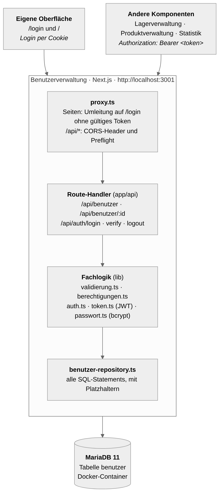
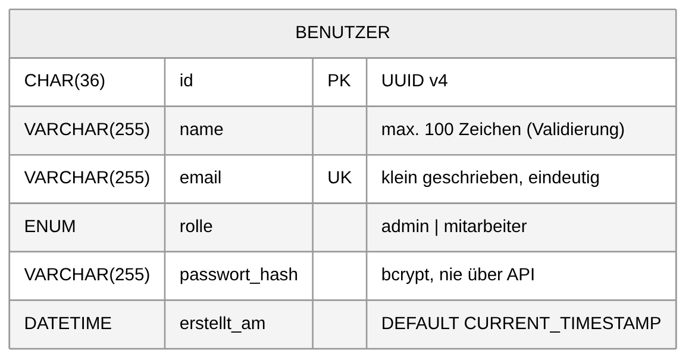
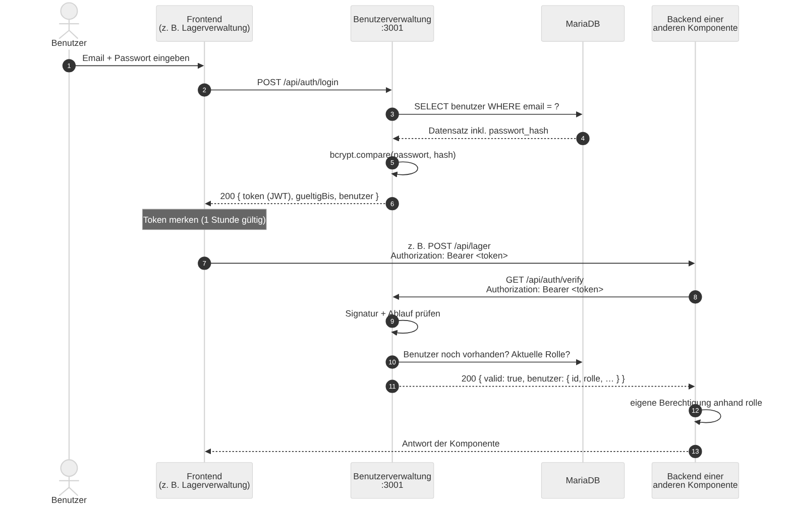
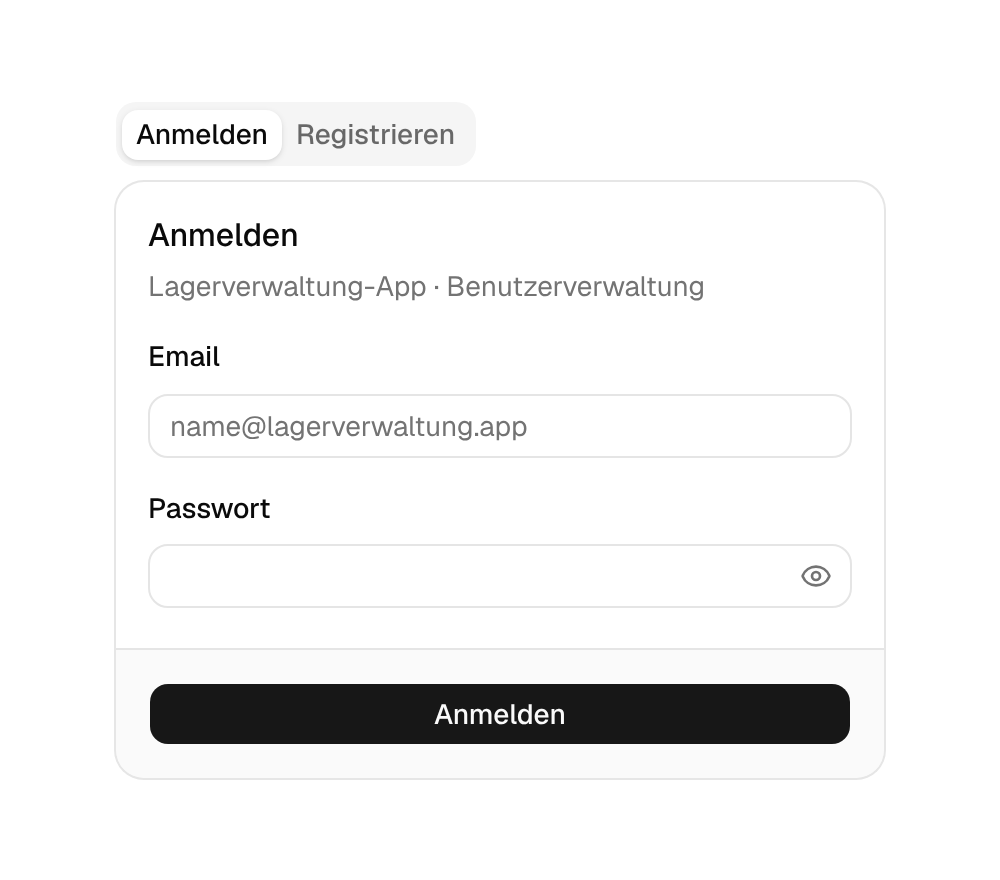
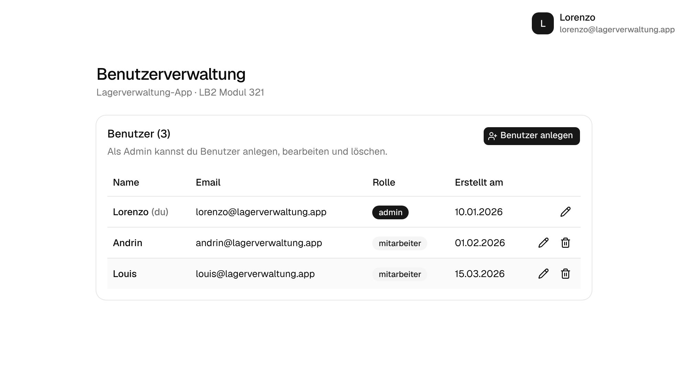
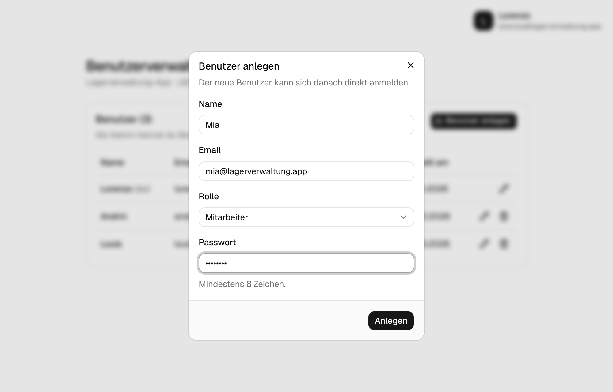
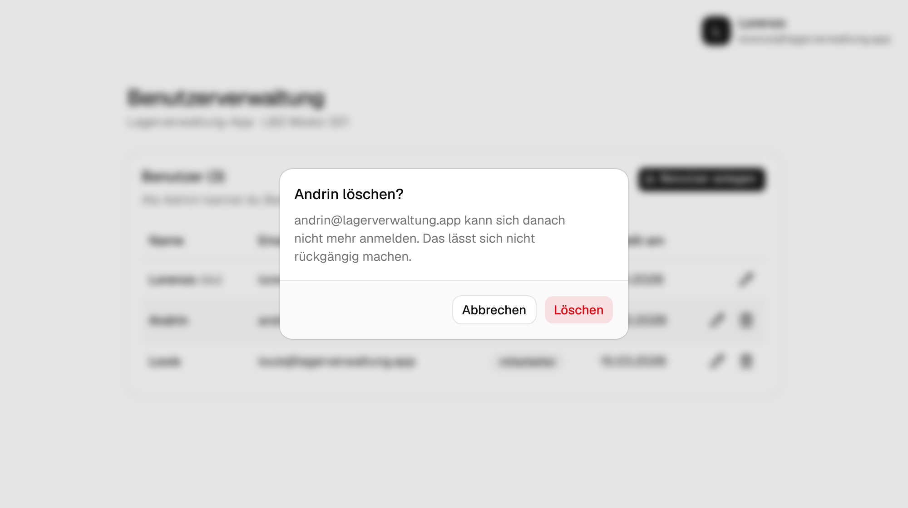

# Systemkomponente Benutzerverwaltung

**Projekt:** Lagerverwaltung-App · LB2 Modul 321 – Verteilte Systeme programmieren
**Verantwortlich:** Lorenzo
**Technologie:** Next.js 16 (TypeScript), MariaDB 11, Docker

---

## 1. Aufgabe der Komponente

Die Benutzerverwaltung ist die zentrale Stelle für alle Benutzer der
Lagerverwaltung-App. Sie hat zwei Aufgaben:

1. **Benutzer verwalten:** Benutzer anlegen, anzeigen, bearbeiten und löschen,
   inklusive Rolle (`admin` oder `mitarbeiter`).
2. **Anmeldung für das ganze System:** Benutzer melden sich hier an und erhalten
   ein Token. Die anderen Komponenten (Lagerverwaltung, Produktverwaltung,
   Statistik) speichern selbst keine Passwörter, sondern fragen bei der
   Benutzerverwaltung nach, ob ein Token gültig ist und welche Rolle der
   Benutzer hat.

Damit gibt es im verteilten System genau eine Komponente, die Passwörter kennt,
und genau eine Stelle, an der festgelegt wird, wer Admin ist.

## 2. Funktionen

**REST-API für die anderen Komponenten**

- Benutzerliste und einzelne Benutzer abrufen (z. B. für die Statistik, um
  Benutzer-IDs in Namen umzuwandeln)
- Login mit Email und Passwort, Ausgabe eines signierten Tokens (JWT, 1 Stunde gültig)
- Token-Prüfung (`/api/auth/verify`), liefert den aktuellen Benutzer inkl. Rolle
- Benutzer anlegen, bearbeiten und löschen mit Berechtigungsprüfung
- Einheitliche Fehlermeldungen mit passenden HTTP-Statuscodes
- CORS, damit die Frontends der anderen Komponenten die API direkt im Browser
  aufrufen können

**Eigene Weboberfläche**

- Anmelden und Registrieren (neue Konten sind immer `mitarbeiter`)
- Benutzerliste mit Rolle und Erstellungsdatum
- Admins: Benutzer anlegen, bearbeiten (inkl. Rolle und Passwort) und löschen,
  mit Sicherheitsabfrage
- Mitarbeiter: eigenes Profil (Name, Email, Passwort) bearbeiten
- Profil-Menü mit Rolle und Abmelden

**Schutzregeln**

- Passwörter werden nur als bcrypt-Hash gespeichert
- Der letzte Admin kann nicht herabgestuft werden, Admins können sich nicht
  selbst löschen. Das System hat also immer mindestens einen Admin.
- Emails sind eindeutig, unabhängig von Gross-/Kleinschreibung

## 3. Technologien und Entscheide

| Bereich            | Wahl                              | Begründung |
| ------------------ | --------------------------------- | ---------- |
| Framework          | Next.js 16 (App Router), TypeScript | API und Oberfläche in einem Projekt, Typen verhindern Fehler zwischen API und UI |
| Oberfläche         | shadcn/ui (Base UI) + Tailwind CSS | fertige, barrierearme Komponenten (Dialoge, Tabellen, Formulare) |
| Datenbank          | MariaDB 11 im Docker-Container    | bekannt aus dem Unterricht, auf jedem Rechner gleich startbar (`npm run db:up`) |
| DB-Zugriff         | `mysql2` mit rohem SQL, kein ORM  | volle Kontrolle über die Queries; alle Statements mit Platzhaltern (`?`) gegen SQL-Injection |
| Passwörter         | `bcryptjs` (10 Runden)            | Standardverfahren mit Salt; reine JS-Bibliothek, läuft ohne Build-Tools unter Windows |
| Token              | JWT (HS256) mit `jose`            | fälschungssicher durch Signatur, Ablaufzeit eingebaut, funktioniert auch im Proxy |
| Tests              | Vitest                            | schnell, versteht TypeScript und die `@/`-Pfade direkt |

**Warum fragen die anderen Komponenten über `/api/auth/verify` nach, statt das
JWT selbst zu prüfen?** So müssen sie den geheimen Schlüssel nicht kennen und
bekommen immer die *aktuelle* Rolle. Wird ein Benutzer gelöscht oder
herabgestuft, wirkt das sofort im ganzen System und nicht erst, wenn das Token
abläuft.

## 4. Aufbau



Die Komponente ist in Schichten aufgebaut. Jede Schicht kennt nur die darunter:

| Schicht | Dateien | Verantwortung |
| ------- | ------- | ------------- |
| Proxy | `proxy.ts` | Läuft vor jedem Request. Leitet Seitenaufrufe ohne gültiges Token auf `/login` um, setzt CORS-Header für `/api/*` und beantwortet Preflight-Requests. |
| Route-Handler | `app/api/**/route.ts` | Nehmen HTTP-Requests entgegen, rufen Validierung, Berechtigung und Repository auf und bauen die Antwort. Enthalten selbst kein SQL. |
| Fachlogik | `lib/validierung.ts`, `lib/berechtigungen.ts`, `lib/token.ts`, `lib/passwort.ts`, `lib/auth.ts`, `lib/api.ts` | Reine Regeln ohne Datenbank, darum einfach testbar. `api.ts` sorgt für einheitliche Fehlerantworten. |
| Datenzugriff | `lib/benutzer-repository.ts`, `lib/db.ts` | Alle SQL-Statements an einem Ort, Verbindungs-Pool zur MariaDB. |
| Oberfläche | `app/page.tsx`, `app/login/page.tsx`, `components/*.tsx` | Server-Komponenten lesen Daten direkt, Client-Komponenten rufen die eigene API auf. |

Ablauf eines Requests am Beispiel `PUT /api/benutzer/:id`:

1. `proxy.ts` setzt die CORS-Header.
2. Der Route-Handler ermittelt den Aufrufer aus Token oder Cookie (`lib/auth.ts`):
   ohne gültiges Token gibt es `401`.
3. Der Ziel-Benutzer wird geladen, sonst `404`.
4. Der Body wird validiert (`lib/validierung.ts`), sonst `400` mit Details.
5. Die Berechtigung wird geprüft (`lib/berechtigungen.ts`), sonst `403`, beim
   letzten Admin `409`.
6. Ist die Email schon vergeben, gibt es `409`.
7. Ein neues Passwort wird gehasht, dann speichert das Repository die Änderung.
8. Unerwartete Fehler fängt `mitFehlerbehandlung` ab und antwortet mit `500`
   im einheitlichen Format.

## 5. Datenmodell



Die Komponente besitzt eine eigene Datenbank mit der Tabelle `benutzer`
(`db/schema.sql`). Andere Komponenten greifen **nie direkt** auf diese
Datenbank zu, sondern nur über die REST-API. Sie speichern bei sich nur die
Benutzer-ID (z. B. "Lagerbewegung erfasst von Benutzer X").

| Spalte | Typ | Beschreibung |
| ------ | --- | ------------ |
| `id` | CHAR(36), Primärschlüssel | UUID, vom Server erzeugt |
| `name` | VARCHAR(255) | Anzeigename (Validierung: max. 100 Zeichen) |
| `email` | VARCHAR(255), eindeutig | wird klein geschrieben gespeichert |
| `rolle` | ENUM('admin','mitarbeiter') | Standard `mitarbeiter` |
| `passwort_hash` | VARCHAR(255) | bcrypt-Hash, verlässt nie die Komponente |
| `erstellt_am` | DATETIME | Erstellungszeitpunkt |

In der API heissen die Felder in camelCase (`erstelltAm`). Die Umwandlung und
das Entfernen des Passwort-Hashes passieren in `toPublicBenutzer()`.

## 6. Schnittstelle

Die vollständige Beschreibung mit Beispielen und allen Fehlercodes steht in
[SCHNITTSTELLE.md](../SCHNITTSTELLE.md). Basis-URL: `http://localhost:3001`

| Methode | Endpunkt | Wer | Antwort |
| ------- | -------- | --- | ------- |
| GET | `/api/benutzer` | alle | `200` Liste |
| GET | `/api/benutzer/:id` | alle | `200` / `404` |
| POST | `/api/benutzer` | Registrierung (nur mitarbeiter) oder Admin | `201` / `400` / `403` / `409` |
| PUT | `/api/benutzer/:id` | Admin oder sich selbst | `200` / `400` / `401` / `403` / `404` / `409` |
| DELETE | `/api/benutzer/:id` | Admin (nicht sich selbst) | `200` / `401` / `403` / `404` |
| POST | `/api/auth/login` | alle | `200` mit Token / `400` / `401` |
| GET | `/api/auth/verify` | mit Token | `200` mit Benutzer / `401` |
| POST | `/api/auth/logout` | alle | `200` |

## 7. Anmeldung und Zusammenspiel mit den anderen Komponenten



1. Das Frontend schickt Email und Passwort an `POST /api/auth/login`.
2. Die Benutzerverwaltung sucht den Benutzer und vergleicht das Passwort mit dem
   bcrypt-Hash. Bei unbekannter Email wird trotzdem ein Vergleich mit einem
   Dummy-Hash gemacht. So dauern beide Fehlerfälle gleich lang, und man kann
   nicht herausfinden, welche Emails registriert sind.
3. Bei Erfolg wird ein JWT erzeugt (Inhalt: Benutzer-ID, Aussteller, Ablaufzeit)
   und mit `JWT_SECRET` signiert.
4. Das Frontend schickt das Token bei Anfragen an andere Komponenten im Header
   `Authorization: Bearer <token>` mit.
5. Die andere Komponente fragt `GET /api/auth/verify` und erhält den aktuellen
   Benutzer mit Rolle zurück. Damit entscheidet sie selbst, was der Benutzer
   darf.

Die eigene Oberfläche der Benutzerverwaltung verwendet dasselbe Token, aber als
**httpOnly-Cookie**. JavaScript im Browser kann es so nicht auslesen, was vor
Cross-Site-Scripting schützt. `proxy.ts` prüft das Cookie bei jedem
Seitenaufruf.

## 8. Berechtigungen

Alle Regeln stehen als reine Funktionen in `lib/berechtigungen.ts` und sind
vollständig per Unit-Test abgedeckt. Die Oberfläche blendet nicht erlaubte
Knöpfe aus, die API prüft die Regeln aber immer selbst.

| Aktion | nicht eingeloggt | mitarbeiter | admin |
| ------ | ---------------- | ----------- | ----- |
| Benutzer lesen | ja | ja | ja |
| Registrieren | nur als mitarbeiter | – | – |
| Benutzer anlegen | – | nein | ja, jede Rolle |
| eigenes Profil bearbeiten | – | ja, ohne Rolle | ja |
| andere bearbeiten, Rollen ändern | – | nein | ja (ausser letzten Admin herabstufen) |
| Benutzer löschen | – | nein | ja, ausser sich selbst |

## 9. Sicherheit

| Massnahme | Umsetzung |
| --------- | --------- |
| Passwörter nie im Klartext | bcrypt mit Salt (`lib/passwort.ts`), Hash wird nie ausgegeben |
| Fälschungssichere Tokens | JWT mit HS256-Signatur und Ablaufzeit, Schlüssel nur in `.env` |
| Keine SQL-Injection | ausschliesslich Platzhalter (`?`), Spaltennamen nur aus fester Liste |
| Keine Rechte-Ausweitung | Registrierung nur als mitarbeiter, Rolle ändern nur durch Admin |
| Kein Aussperren | letzter Admin bleibt immer erhalten |
| Keine Email-Erkennung beim Login | gleiche Antwort und gleiche Dauer für "Email unbekannt" und "Passwort falsch" |
| Cookie-Schutz | httpOnly, SameSite=Lax, Secure bei HTTPS |
| Eingaben prüfen | alle Bodies werden validiert, unbekannte Felder ignoriert |
| Keine internen Details in Fehlern | `500` enthält nur eine allgemeine Meldung, Details stehen im Server-Log |

## 10. Oberfläche

| Anmelden | Benutzerliste (Admin) |
| -------- | --------------------- |
|  |  |

| Benutzer anlegen | Benutzer löschen |
| ---------------- | ---------------- |
|  |  |

## 11. Installation und Betrieb

Voraussetzungen: Node.js 20+, Docker Desktop.

```bash
npm install
cp .env.example .env    # JWT_SECRET auf einen eigenen Zufallswert setzen
npm run db:up           # MariaDB-Container starten
npm run db:reset        # Tabelle + Testbenutzer
npm run dev             # http://localhost:3001
```

Testbenutzer: `lorenzo@lagerverwaltung.app` / `lorenzo123` (admin),
`andrin@…` / `andrin123` und `louis@…` / `louis123` (mitarbeiter).

Für die Integration mit den anderen Komponenten:

- Die Benutzerverwaltung läuft fest auf **Port 3001**.
- Die Frontends der anderen Komponenten müssen in `CORS_ORIGINS` stehen
  (Standard: Ports 3000, 3002, 3003, 3004).
- Läuft auf dem gleichen Rechner bereits eine andere Datenbank auf Port 3306,
  in `.env` z. B. `DB_PORT=3307` setzen. `docker-compose.yml` übernimmt den Wert.

## 12. Tests

Die Komponente wird auf drei Ebenen getestet. Testfälle, Testumgebung und
Testprotokoll stehen in [TESTS.md](TESTS.md).

| Ebene | Werkzeug | Umfang |
| ----- | -------- | ------ |
| Unit-Tests | Vitest (`npm test`) | 96 Tests für Validierung, Berechtigungen, Token, Passwort, CORS, Proxy und alle Route-Handler (mit In-Memory-Datenbank); Abdeckung ca. 99 % |
| API-Tests | Vitest gegen laufenden Server (`npm run test:api`) | 19 Tests über HTTP mit echter MariaDB |
| UI-Tests | im Browser (Chromium) | 11 Abläufe: Login, Registrieren, Anlegen, Bearbeiten, Löschen, Rollen |

## 13. Fazit und Ausblick

**Fazit:** Die Benutzerverwaltung erfüllt die mit der Gruppe vereinbarte
Schnittstelle und ergänzt sie um ein sicheres Login, das alle Komponenten
gemeinsam nutzen. Die Trennung in Proxy, Route-Handler, Fachlogik und
Repository hat sich bewährt. Die Regeln für Validierung und Berechtigungen
liessen sich ohne Datenbank testen, und Änderungen an einer Stelle haben die
anderen nicht beeinflusst. Wichtigste Erkenntnis: Eine Schnittstelle früh
schriftlich festzuhalten (`SCHNITTSTELLE.md`) spart viel Abstimmung. Spätere
Erweiterungen wie Fehlercodes und Login-Pflicht für `PUT`/`DELETE` mussten
trotzdem nochmals mit der Gruppe besprochen werden.

**Ausblick / mögliche Erweiterungen:**

- `GET /api/benutzer` ebenfalls nur mit Token erlauben (aktuell gemäss
  Absprache offen, damit die Statistik einfach darauf zugreifen kann)
- Token vorzeitig ungültig machen können (Sperrliste), damit ein Logout
  sofort im ganzen System wirkt
- Schutz gegen viele Login-Versuche (Rate-Limiting)
- "Passwort vergessen"-Funktion per Email
- Betrieb über HTTPS und mit einem gemeinsamen API-Gateway für alle Komponenten
